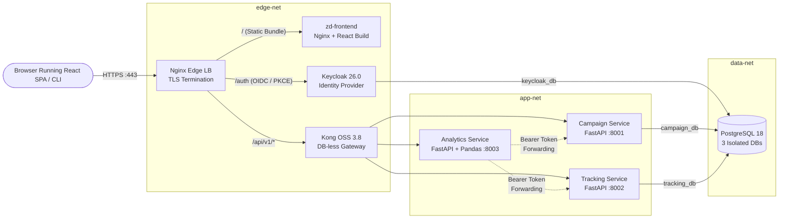

# Zero-Dose Tracking Platform

A secure, containerised microservices platform for tracking zero-dose vaccination campaigns, registering beneficiaries, replaying longitudinal field encounters, and monitoring round-to-round immunisation coverage. Built with strict **database-per-service isolation**, **Keycloak OIDC/PKCE RBAC**, **deterministic event replay**, and **low-memory container caps** verified end-to-end via GitHub Actions.

---

## Architecture Overview



### Key Design Principles
* **Database-per-Service Isolation:** `campaign_db`, `tracking_db`, and `keycloak_db` run with dedicated least-privilege PostgreSQL roles—no cross-database SQL joins or foreign keys.
* **Stateless Analytics & Event Replay:** `analytics-service` has no database credentials and no access to `data-net`; it fetches rounds and append-only encounters via Bearer-token forwarding over `app-net` to compute live KPIs and round-to-round transitions.
* **Local JWT Verification:** Services cache Keycloak's public JWKS keys in memory (RS256) and enforce `admin` / `field_worker` RBAC via `services/shared/auth.py` without per-request IdP round-trips.
* **Idempotent Baseline Seeding:** On startup (after `alembic upgrade head`), `campaign-service` and `tracking-service` idempotently load baseline campaign rounds (`R1`–`R3`) and field encounters (`E0001`–`E0130`) without duplicating records across restarts.
* **Strict Memory Footprint:** Every container enforces explicit `mem_limit` caps, allowing the entire 8-container stack to run comfortably within ~1.7 GB RAM.

---

## Domain Logic & Event-Replay Rules

The `analytics-service` deterministic event-replay engine (`services/analytics-service/app/replay.py`) evaluates encounters chronologically by `recorded_at` and enforces five operational rules (locked down by `services/analytics-service/tests/test_replay.py`):

1. **Intra-Round Corrections (`C043`):** Explicit negative answers (e.g. `E0094` correcting `E0070` with a supervisor/card note) reset the child's status back to Zero-Dose (`true`) for that round while preserving every event in the immutable audit trail.
2. **Intra-Round Duplicate Revisits (`C027`):** When multiple revisits occur in the same round (e.g. `E0078` then `E0081`), the last decisive encounter chronologically sets the round's effective status.
3. **Unanswered / Null Revisits:** Revisit records with `vaccinated_since_last = null` (and `vaccinated_elsewhere != true`) are persisted to record field presence, but preserve the child's prior `zero_dose` state without emitting a transition.
4. **External Vaccination Confirmation (`C016`):** Encounters with `vaccinated_elsewhere = true` transition the child to Vaccinated (`false`) and tag `confirmation_method = "External (Vaccinated Elsewhere)"`.
5. **Round-to-Round Transitions:** A child is counted as transitioned from Round A → Round B if and only if their effective end-of-round status was Zero-Dose (`true`) in Round A and Vaccinated (`false`) in Round B.

---

## Service & Resource Matrix

| Container | Stack | Profile(s) | Networks | RAM Cap | Role & Key Endpoints |
| :--- | :--- | :--- | :--- | :--- | :--- |
| `zd-nginx` | Nginx 1.27 Alpine | `core`, `auth`, `full` | `edge-net` | `64m` | Edge LB, TLS termination, `/healthz` |
| `zd-frontend` | React 18, Vite, TS, Nginx | `full` | `edge-net` | `64m` | Role-aware SPA with Keycloak PKCE (`S256`) |
| `zd-kong` | Kong OSS 3.8 (DB-less) | `auth`, `full` | `edge-net`, `app-net` | `256m` | Declarative API routing, CORS, rate limiting (`100 req/min`) |
| `zd-keycloak` | Keycloak 26.0 | `auth`, `full` | `edge-net`, `app-net`, `data-net` | `512m` | Identity Provider (`zero-dose-realm`, auto-imported) |
| `zd-postgres` | PostgreSQL 18 Alpine | `core`, `auth`, `full` | `data-net` | `256m` | Isolated databases & least-privilege roles |
| `zd-campaign-service` | FastAPI, SQLAlchemy, Alembic | `full` | `app-net`, `data-net` | `192m` | Campaign CRUD & baseline rounds (`/api/v1/campaigns`, `/api/v1/rounds`) |
| `zd-tracking-service` | FastAPI, SQLAlchemy, Alembic | `full` | `app-net`, `data-net` | `192m` | Beneficiaries, vaccinations & append-only encounters (`/api/v1/beneficiaries`, `/api/v1/vaccinations`, `/api/v1/encounters`) |
| `zd-analytics-service` | FastAPI, Pandas | `full` | `app-net` | `192m` | Coverage KPIs, district metrics & event-replay transitions (`/api/v1/analytics/summary`, `/api/v1/analytics/transitions`, `/api/v1/analytics/children/{child_id}/timeline`, `/api/v1/metrics/coverage`) |

---

## Quick Start (Docker / GitHub Codespaces)

### 1. Clone & Configure Environment
```bash
git clone [https://github.com/SR-TechSandbox/zero-dose-tracking-platform.git](https://github.com/SR-TechSandbox/zero-dose-tracking-platform.git)
cd zero-dose-tracking-platform
cp .env.example .env
```

### 2. Generate Local Self-Signed TLS Certificates
```bash
chmod +x infra/postgres/init-databases.sh infra/nginx/generate-certs.sh
./infra/nginx/generate-certs.sh
```

### 3. Boot the Full 8-Container Stack
```bash
docker compose --profile full up -d --build
```

*(Optional lighter profiles: `--profile core` for Postgres + Nginx, or `--profile auth` for Postgres + Keycloak + Kong + Nginx.)*

### 4. Access the Platform
* **Web SPA:** `https://localhost/` *(accept the self-signed certificate warning in your browser)*
* **Keycloak Admin Console:** `https://localhost/auth/admin`
* **Edge Health Check:** `https://localhost/healthz`

---

## Demo Credentials & RBAC Matrix

The Keycloak realm (`zero-dose-realm`) is auto-imported on startup with two pre-configured users:

| Username | Password | Role | Permissions |
| :--- | :--- | :--- | :--- |
| `admin` | `AdminPass123!` | `admin` | Full access: create/update campaigns, view district coverage metrics, view round transitions & child timelines, register beneficiaries, log vaccinations & encounters |
| `worker` | `WorkerPass123!` | `field_worker` | Field access: view campaigns, rounds, summary KPIs & transitions, register beneficiaries, log vaccinations & encounters (blocked `403` on campaign creation & admin district metrics) |

---

## Repository Structure

```text
.
├── .github/workflows/          # Automated CI verification gates (Phases 1–3)
├── data/
│   └── baseline/               # Idempotent seed datasets (rounds.json, encounters.jsonl)
├── docs/
│   ├── ai-context/             # Architecture lock & session state
│   └── specs/                  # Phase 1, 2, and 3 technical specifications
├── frontend/                   # React + Vite + TypeScript SPA + multi-stage Dockerfile
├── infra/
│   ├── keycloak/               # Auto-imported realm-export.json
│   ├── kong/                   # DB-less declarative kong.yml
│   ├── nginx/                  # Edge LB config & TLS cert generator
│   └── postgres/               # Isolated DB & role bootstrap script
├── services/
│   ├── shared/                 # Reusable Keycloak JWKS cache & FastAPI RBAC middleware
│   ├── campaign-service/       # FastAPI + Alembic + baseline rounds seeder + pytest
│   ├── tracking-service/       # FastAPI + Alembic + baseline encounters seeder + pytest
│   └── analytics-service/      # Stateless FastAPI + Pandas + event-replay engine + pytest
├── docker-compose.yml
└── Makefile
```

---

## CI/CD Verification Gates

All phases are automatically verified on GitHub Actions (`ubuntu-latest`):
1. **Phase 1 (`verify-phase1.yml`):** Boots core infra, verifies Nginx TLS, Kong rate-limiting headers, Keycloak JWKS, and JWT minting.
2. **Phase 2 (`verify-phase2.yml`):** Runs `pytest` across all Python test suites (including the 5 event-replay domain rules), boots the 7-container backend stack, and executes an E2E RBAC & data-flow test (`401` → `403` → `201` → `200`).
3. **Phase 3 (`verify-phase3.yml`):** Runs TypeScript/Vite production build, boots all 8 containers with baseline seeders, and verifies HTTPS SPA delivery alongside API regression checks.

---

## License
This project is licensed under the MIT License